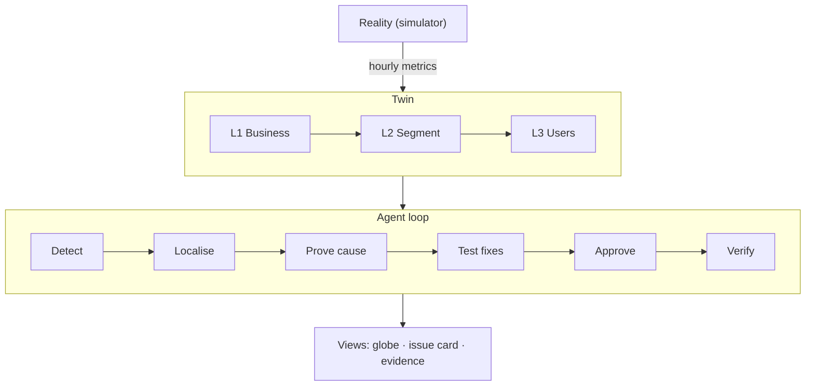

# Argus

**A self-driving analyst that lives inside a causal digital twin of a rewarded-ad marketplace.**
HackLab #2 Berlin Robotics & AI Hackathon, Almedia track ("Eye of the System"), 21–22 Nov 2026.

Rewarded-ad marketplaces like Freecash move fast: a bot farm looks like growth, a broken advertiser postback looks
like a dip, a planned promo looks like an anomaly. Argus watches 20 countries × 6 KPIs every hour against a digital
twin that learned the business from 14 days of data. When something breaks, it localises the problem (country →
platform × offer category → individual users), walks the causal graph to separate root cause from symptoms, **proves
the cause with a counterfactual in the twin**, fast-forwards every candidate fix 7 days before touching anything,
recommends one, and — after a human clicks Approve — checks 24 h later whether its prediction came true. Each
incident is explained three ways: a plain issue card for the CEO, an action plan for the manager, and the
z-scores, Shapley contributions and query trail for the engineer.

**Try it live: https://argus-cmlk.onrender.com** (first load may take ~50 s on the free tier while the container wakes up).

## Architecture



Approved fixes are applied back to Reality, and the next hours of data show whether they worked.

Design notes and the original build plan: [`docs/HANDOFF.md`](docs/HANDOFF.md); API contract: [`docs/API.md`](docs/API.md).

Argus never reads the simulator's hidden state (bot labels, farms, breaks); a test enforces it. It sees only the
observed metric stream, the public marketing calendar, unlabeled user samples and the actions it applied.

## What is real vs simulated

- **Real (public data, cited):** scale ($1B run rate → $2.74M revenue/day), each country's share of user payouts
  (US 57.9%, DE 9.7%, GB 8.2%, CA 3.7%, FR 3.2%), iOS share per country (StatCounter, Oct 2026), country payout
  levels and the iOS premium (AppsFlyer CPI benchmarks, Q3 2026). See [`docs/DATA_SOURCES.md`](docs/DATA_SOURCES.md)
  and the in-app Data panel (`GET /api/meta`).
- **Simulated:** offer categories and conversion rates, taste archetypes and regional mixes, the production feed,
  noise, the incidents, advertiser reactions and fix effects. See [`docs/ASSUMPTIONS.md`](docs/ASSUMPTIONS.md).
- No private Almedia data is used.

## Demo scenes

The **Demo** menu in the top bar (or `POST /api/demo/{scene}`) jumps a fixed-seed world to each part of the story;
calling a later scene first runs the earlier ones.

| Scene | What happens |
|---|---|
| `start` | Fresh world after 14 days of history; the globe is green, 20 countries × 6 KPIs watched |
| `promo` | Planned "Weekend Boost" in Germany: a naive detector alerts, Argus logs it as explained by the calendar |
| `bot_farm` | Fake accounts on Android in Canada: revenue goes *up*; Argus opens a high-severity incident within ~3 h |
| `investigate` | Decision trail: country → Android × fintech/strategy → root cause new accounts → user-level taste check → counterfactual (~94% explained) |
| `approve` | Human approves the recommended fix (verify new accounts); Canada returns to green within ~2 h |
| `verify` | 24 h later: actual margin lands inside the predicted band → "Prediction verified" |
| `new_metric` | "Reward cost per completed offer" is added in plain words, validated and monitored |
| `tracking_break` | Advertisers stop confirming UK iOS game completions: root cause revenue, no user-level run needed, pause + notify |

Keyboard shortcuts (**coming**): `1`–`8` jump to the scenes above and `Space` plays/pauses. They arrive with the
frontend redesign currently in progress; until then the Demo menu and the top-bar controls (play, +1 h, +6 h, inject,
add metric) drive everything.

## Honest limitations

- **The marketplace is simulated.** Scale, country mix, platform split and payout levels are calibrated to public
  figures; conversion rates, taste, incidents and advertiser behaviour are invented. Numbers are illustrative, not
  forecasts for Almedia.
- **Incidents are injected**, and the twin was designed with these failure modes in mind; unknown failure types would
  surface as "anomaly, cause unclear" rather than a confident diagnosis.
- **Fix effects in the twin are assumptions** (e.g. verification removes 95% of fake activity), validated only against
  the simulator. Verification after 24 h checks the prediction, not the assumption.
- **Potential mode is conservative and model-dependent:** the twin shows +2–3.5% margin from a taste-matched feed;
  the simulator's truth for the same feed is higher, because the twin's taste model is flatter than reality.
- **One country can carry one open incident at a time**; overlapping causes in the same country are not separated.
- **Free-tier hosting:** sessions live in memory (up to 13, idle expiry 30 min, LRU eviction); a restart resets them.
- LLM-written reports are optional; without a key Argus uses deterministic templates.

## Run the backend
```bash
cd backend
python -m venv .venv && .venv/bin/pip install -r requirements.txt
.venv/bin/python -m pytest -q          # unit + end-to-end demo tests
.venv/bin/uvicorn argus.api:app --reload --port 8000
./run_demo_server.sh                   # for video recording: port 8000, no --reload
```
API contract: [`docs/API.md`](docs/API.md). Jump to a video scene with `POST /api/demo/{scene}`
(`start`, `promo`, `bot_farm`, `investigate`, `approve`, `verify`, `new_metric`, `tracking_break`).
Optional LLM (OpenAI-compatible): set `LLM_BASE_URL`, `LLM_API_KEY`, `LLM_MODEL`; deterministic templates otherwise.

## Run in Docker (frontend + API on one port)
```bash
docker build -t argus .
docker run -p 7860:7860 argus            # open http://localhost:7860
# optional LLM reports: add -e LLM_BASE_URL=... -e LLM_API_KEY=... -e LLM_MODEL=...
```
Port 7860 matches Hugging Face Spaces (Docker SDK). Secrets are never baked into the image.

## Deploy on Render
1. Push this repo to GitHub (done: `ETohidi/argus`).
2. In Render: **New → Blueprint**, pick the repo. Render reads `render.yaml` and creates one free web service
   (Docker runtime, root `Dockerfile`, health check `/api/health`).
3. When prompted, paste `LLM_API_KEY` (marked `sync: false`, so it lives only in Render). `LLM_BASE_URL` and `LLM_MODEL`
   are preset; leave the key empty to run with template reports.
4. Open the service URL: the globe is served at `/`, the API at `/api`. Render sets `$PORT`; uvicorn listens on it.

Free instances sleep when idle; the first request after a pause takes ~30–60 s (the world is rebuilt per session).
